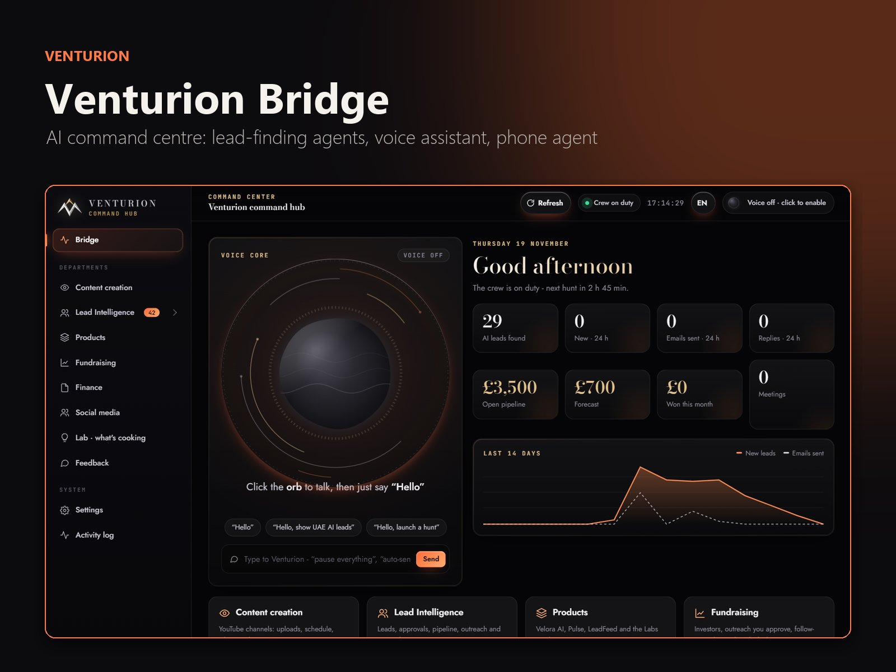
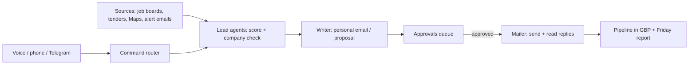
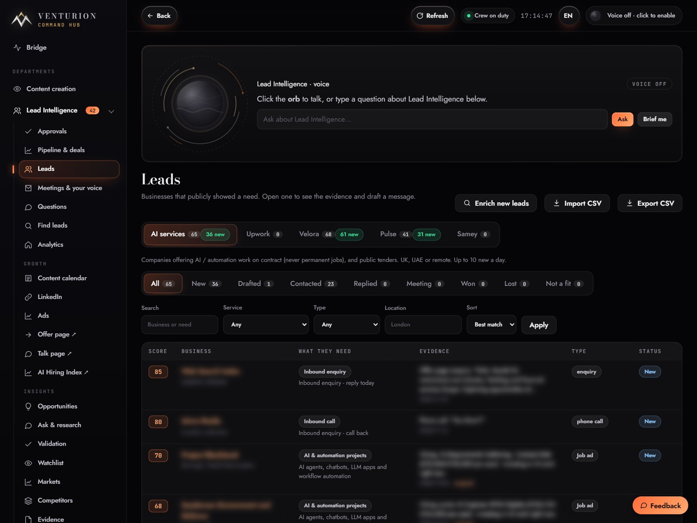
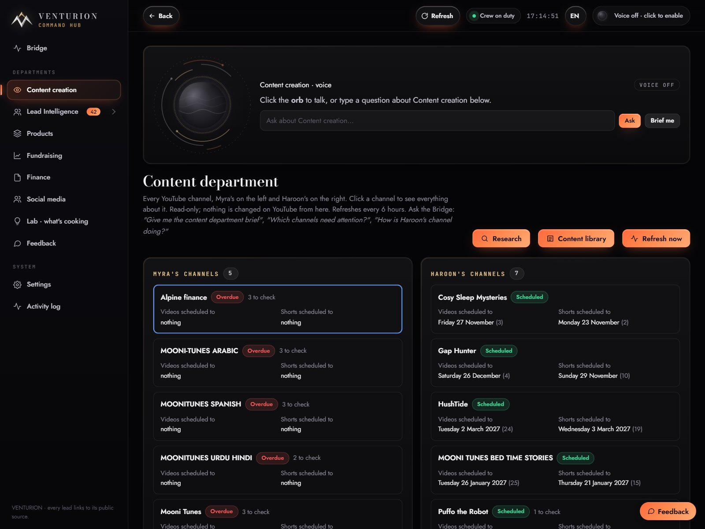

# Venturion Bridge - AI command centre

The operating system of an AI studio. One dashboard where AI agents find clients, write to them, and report back - with a person approving anything that leaves the building.

## What it does
- **Lead-finding agents** search job boards, public tenders, Google Maps and freelance-site alerts every day, score each lead, and check the business is a real registered company before any email goes out.
- **Writes the first message**: a personal email or proposal per lead, waiting in an approvals queue. Sending is crash-safe and capped per day.
- **Voice assistant** in English and Urdu: "Hello, brief me", "pause everything", "show UAE AI leads".
- **AI phone receptionist** (in testing) with test mode, an emergency stop, a monthly spend cap and a call-length limit.
- **Content department**: a YouTube dashboard for 12 channels, long videos and Shorts side by side, with schedule dates.
- **Products department**: uptime checks for every live product - one alert when something goes down, one when it's back.
- **Lab**: two AI coding assistants on two laptops message each other and the owner through the Bridge.

## How it works

## Built with
Python, FastAPI, SQLite (WAL, indexed, backed up), Claude API, local text-to-speech, IMAP/SMTP, Telnyx voice, Tailscale and a Cloudflare tunnel. 20,000+ lines and 90 test files; every fix lands with its own test.

## Screenshots

## About this repository
This is a showcase: what the product does, how it is built and what it looks like. The source code is private. Want something like this for your business? Book a 15-minute call: https://cal.com/haroon-younis-p9tjo5/intro - or visit https://venturionai.com

Built by **VENTURION**, an AI agents & automation studio in London.
